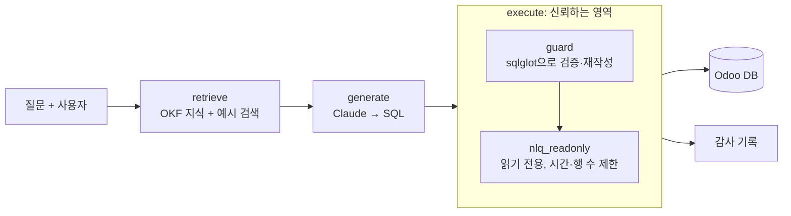

# erp-nlq


ERP 데이터를 한국어로 물으면 SQL로 바꿔 답하되, 사용자 권한 밖의 데이터는 LLM이 어떤 SQL을 만들어도 나오지 않도록 코드로 강제하는 프로젝트입니다.

데이터 소스는 Odoo Community 19.0 (LGPL-3.0)이며, Odoo 코드는 수정하지 않습니다. DB에는 읽기 전용 역할을 추가하고, PUBLIC에 열린 스키마 생성·임시 테이블 권한만 회수합니다.

> 상태: 계획한 1·2단계 기능을 모두 마쳤습니다(2026-11-09). 숫자는 [docs/plan.md](docs/plan.md)의 측정 기록에서 옮겼습니다. 하지 않기로 한 기능은 plan.md "2차 목록"에 있습니다.

**데모 영상 (1분 13초):** [docs/demo/erp-nlq-demo.mp4](docs/demo/erp-nlq-demo.mp4). 관리자와 영업 사원에게 같은 질문을 했을 때의 결과 범위, 직접 고친 SQL에도 걸리는 권한, 위험한 SQL과 권한 밖 테이블 거부, 되묻기, 평가 결과 순서로 보여 드립니다. 화면 아래 자막만 있고 소리는 없습니다.

- **기간:** 2026-10-23 기획, 2026-11-03 ~ 11-10 개발 (PR 51개)
- **인원:** 1명. Claude Code와 짝으로 작업했습니다. 누가 무엇을 했는지는 [제가 한 일](#제가-한-일)에 적었습니다.

## 목차

- [무엇이 다른가](#무엇이-다른가) · [결과](#결과) · [로컬 실행](#로컬-실행) · [평가](#평가) · [한계](#한계) · [CI](#ci)
- [기술 스택](#기술-스택) · [진행 과정](#진행-과정) · [제가 한 일](#제가-한-일) · [트러블슈팅](#트러블슈팅) · [회고](#회고)

## 무엇이 다른가

자연어 → SQL 도구는 대개 "맞는 SQL을 만드는 것"을 목표로 합니다. 하지만 업무 시스템에서는 그 SQL이 **질문한 사람이 볼 수 있는 행만** 읽어야 합니다. 영업 사원은 자기 주문과 담당자 없는 주문만 보고, 재고 담당은 고객 송장을 보지 못하는 식입니다(Odoo의 Record Rules).

이 프로젝트는 LLM의 출력을 신뢰하지 않습니다. 권한은 프롬프트가 아니라 실행 단계에서 코드로 겁니다.



- **guard**([backend/nlq/guard.py](backend/nlq/guard.py)): SQL을 구문 트리로 읽어 문장 하나·SELECT만 허용하는지, 테이블·함수·형이 허용 목록에 있는지 검사합니다. 행 범위가 있는 테이블은 권한 조건이 걸린 서브쿼리로 바꿔 끼웁니다. 규칙은 Odoo 그룹과 Record Rules를 옮긴 것입니다([ADR 0003](docs/adr/0003-guard-rules-from-odoo-groups.md)).
- **RLS**: 같은 규칙을 Postgres RLS 정책으로도 구현해 비교했습니다(`NLQ_ENFORCE=guard|rls|both`, [ADR 0005](docs/adr/0005-rls-vs-guard.md)).
- **DB 역할**: 질의 계층은 superuser가 아닌 `nlq_readonly`·`nlq_rls`로만 접속합니다. 쓰기, 위험 함수, 허용 밖 테이블은 DB 권한에서도 막습니다.
- **감사 기록**: `execute()`가 시도마다 사용자·시각·결과 종류·값을 가린 SQL을 남깁니다. 질문 원문과 값은 남기지 않습니다([ADR 0006](docs/adr/0006-audit-log.md)).
- **왜 Odoo ORM API가 아니라 SQL인가**: ORM은 권한을 스스로 걸지만 `read_group`으로는 조인·구간 합계를 한 번에 하지 못합니다. 또 이 프로젝트는 자연어 → SQL 도구가 만든 임의의 SQL에서도 권한이 지켜지는지를 잽니다([ADR 0008](docs/adr/0008-sql-over-orm-api.md)).

구조와 신뢰 경계는 [docs/architecture.md](docs/architecture.md)에 있습니다.

## 결과

평가 세트는 50문항(판매 13·구매 12·재고 12·회계 13)입니다. 문항마다 질문하는 사용자가 정해져 있습니다. 정답 SQL과 생성 SQL을 **그 사용자의 권한 범위로** 실행해 결과 집합을 비교합니다(열 이름·반올림·행 순서 무시, [eval/README.md](eval/README.md)). 모델은 claude-haiku-5-5입니다.

### 권한

| 항목 | 결과 |
|---|---|
| Odoo 행 수 일치 (사용자 6명 × 테이블 14개, guard·RLS·둘 다) | 84/84 |
| 우회 테스트 (`backend/tests/test_guard.py`, RLS만 걸어도) | 통과 |
| Odoo 보고서 대조 (매출·수주액·미수금, 사용자별 17항목) | 정의 SQL 17/17, 시스템 답 17/17 |

### 정확도와 지식 층

| 구성 | 정답 (50문항) |
|---|---|
| 스키마만 (프롬프트만) | 41.0 (3회 평균) |
| 스키마 + 예시 검색 (RAG만, 키워드) | 41.7 (3회 평균) |
| 스키마 + 도메인 지식 묶음(OKF) | 45.7 (3회 평균) |
| OKF + 예시 검색(키워드) | 48.0 (3회 평균) |
| **OKF + 예시 검색 + 되묻기 (최종 구성)** | **48.3 (11-07 3회), 49.0 (11-09 3회)** |

- 도메인 지식 묶음(OKF, [knowledge/](knowledge/))은 테이블 14개, 데이터 함정 8개, 업무 흐름 2개, 매출·미수금 정의로 이루어져 있습니다. 예시만으로는 이를 대신하지 못합니다. 회계에서 가장 큰 차이가 났습니다(RAG만 9.7/13 vs OKF + RAG 13.0/13).
- 최종 구성(OKF + 예시 검색 + 되묻기)을 claude-opus-5-5로 한 번 재면 47/50입니다. Haiku의 같은 구성(세 번 48·48·49)과 회차 변동(±1~2) 안에 있어, 이 구성에서는 큰 모델로 바꿔도 점수가 오르지 않습니다.
- 업무 기준이 갈리는 질문(주문/송장, 부가세, 환불 차감)에는 SQL 대신 되묻습니다. 되묻기 세트 8문항에서 끝까지 정답인 문항이 3.7개에서 8.0개로 늘었습니다. 기준이 정해진 50문항에서는 150번 중 한 번도 되묻지 않았습니다.

### WrenAI와 비교 (비교 기준 2)

같은 50문항과 채점 규칙, 같은 모델, 같은 지식(`knowledge/`, `eval/examples/`)을 WrenAI 0.29.2에 넣고 쟀습니다. 각각 세 번의 평균입니다(WrenAI 2026-11-08 한 번·11-09 두 번, 이 시스템 11-09 세 번, [docs/reference/wrenai.md](docs/reference/wrenai.md)).

| | 정답 | 우회 (권한 밖 행이 결과에 섞인 문항) |
|---|---|---|
| 이 시스템 | 49.0/50 (49·49·49) | 0 |
| WrenAI, 직접 실행 | 27.0/50 (27·27·27) | 9.3 (영업 사원 질문 15개 중, 9·9·10) |
| WrenAI SQL을 이 시스템의 `execute()`로 실행 | 33.0/50 (31·34·34) | 0 |

WrenAI 오픈소스에는 행 범위 기능이 없습니다. 같은 SQL이라도 `execute()`를 거치면 범위가 걸려 평균 6문항이 더 정답이 됩니다. WrenAI 엔진은 Odoo의 번역 jsonb 열(`name->>'en_US'`)을 다루지 못해, 품목 이름이 필요한 문항에서 많이 틀렸습니다.

측정 조건과 회차별 숫자는 [docs/plan.md](docs/plan.md)에, 결정 기록은 [docs/adr/](docs/adr/)에 있습니다.

## 로컬 실행

준비물: Docker, [uv](https://docs.astral.sh/uv/)(Python 3.12), Node.js·npm, Claude API 키(`ANTHROPIC_API_KEY`). Odoo와 Postgres는 127.0.0.1에만 열립니다.

```bash
cp .env.example .env
docker compose up -d
```

1. 데모 데이터와 판매·구매·재고·회계 앱이 들어간 DB를 만듭니다. Odoo 19는 기본값이 데모 데이터 없음이라 `--with-demo`가 필요합니다.

```bash
set -a; source .env; set +a
docker compose exec -T odoo odoo server --db_host db -r odoo -w "$ODOO_DB_PASSWORD" \
  -d "$ODOO_DB_NAME" -i sale_management,purchase,stock,account \
  --with-demo --stop-after-init --http-port 8070
```

2. 읽기 전용 역할(`nlq_readonly`, RLS 비교용 `nlq_rls`)과 RLS 정책을 만듭니다. 테이블 목록이나 `backend/nlq/identity.py`의 규칙을 고친 뒤에도 다시 실행합니다.

```bash
./scripts/db-readonly-role.sh
```

3. 역할별 사용자(영업 사원 4명, 재고 담당 1명)를 만들고 주문·송장 담당자를 나눈 뒤, 평가용 기준 스냅숏을 저장합니다. 데모의 Marc Demo에서 재고 그룹을 빼므로 원래 데모 설정과 다릅니다([ADR 0002](docs/adr/0002-separate-sales-and-stock-roles.md)).

```bash
./scripts/db-seed.sh
./scripts/db-snapshot.sh save
```

같은 상태로 되돌리려면 `./scripts/db-snapshot.sh restore erp-YYYYMMDD.zip`을 실행합니다.

http://localhost:8069 에 데모 관리자 계정으로 로그인할 수 있습니다.

4. 화면을 띄웁니다. API(127.0.0.1:8000)와 Next.js(127.0.0.1:3000)를 각각 실행합니다. `.env`에 `ANTHROPIC_API_KEY`가 있어야 질문이 SQL로 바뀝니다.

```bash
uv run --directory backend nlq-api
```

```bash
npm --prefix web install
npm --prefix web run dev
```

http://127.0.0.1:3000 에서 사용자를 고르고 질문합니다. 만들어진 SQL은 고쳐서 다시 실행할 수 있고, 어느 쪽이든 `execute()`가 고른 사용자의 권한 범위를 겁니다. 로그인이 없는 데모라 두 서버 모두 127.0.0.1에만 엽니다.

터미널에서도 같은 순서(질문 → SQL → `execute()`)로 물을 수 있습니다.

```bash
uv run --directory backend nlq "지난달 확정된 판매 주문은 몇 건이야?" --user sales.kim
```

## 평가

```bash
uv run --directory backend pytest                    # 권한·우회·채점 테스트
uv run --directory backend nlq-eval                  # 50문항, 영역별 정확도
uv run --directory backend nlq-eval --clarify-set    # 되묻기 세트
uv run --directory backend nlq-report                # Odoo 보고서 대조
uv run --directory backend nlq-eval-wren setup|run   # WrenAI 비교 (docs/reference/wrenai.md)
```

평가 문항(`eval/questions/`)은 프롬프트 예시로 쓰지 않습니다. 예시는 `eval/examples/`에서만 가져오고, 둘이 겹치지 않는지 테스트가 검사합니다.

## 한계

- **데이터가 작습니다.** Odoo 데모 데이터(판매 주문 24건)라 guard와 RLS의 실행 시간 차이가 접속 시간에 묻혔습니다. 큰 테이블에서는 재지 않았습니다([ADR 0005](docs/adr/0005-rls-vs-guard.md)).
- **평가 세트는 직접 만든 50문항입니다.** 한 스냅숏(`erp-20261103.zip`)과 고정한 "오늘"(2026-11-03)에서 쟀습니다. 회차 변동이 ±1~2문항이라 그보다 작은 차이는 의미 있게 보지 않습니다. Opus는 최종 구성을 한 번만 쟀습니다.
- **필드 단위 권한은 대조하지 않았습니다.** 행 범위와 테이블 권한은 Odoo와 맞췄지만, 허용 테이블 안 필드에 걸린 그룹 제한은 따로 보지 않았습니다(`res_users`만 열 5개로 좁힘, [ADR 0008](docs/adr/0008-sql-over-orm-api.md)).
- **감사 기록은 로컬 파일입니다.** 변조를 막지 못합니다([ADR 0006](docs/adr/0006-audit-log.md)).
- **화면에는 로그인이 없습니다.** 사용자를 고르는 기능은 데모용입니다. 그래서 API와 화면을 127.0.0.1에만 엽니다.
- **WrenAI 비교는 한 버전(0.29.2)만 쟀습니다.** 세 번의 측정이 이틀(11-08, 11-09)에 걸쳤습니다. ORM API 방식의 정확도는 재지 않았습니다(2차 목록).

## CI

PR마다 `checks`(결정적 검사)와 `ai-review`(Claude 리뷰, [.github/review/prompt.md](.github/review/prompt.md))가 실행됩니다. 둘 다 main 브랜치 보호의 필수 체크입니다. `checks`는 허용 테이블 축소 덤프(`eval/ci/erp-ci.sql.gz`)를 Postgres에 복원해 DB 테스트를 돌리고, 평가 20문항을 claude-haiku-5-5로 채점해 18 미만이면 실패합니다. `checks`에는 레포 시크릿 `ANTHROPIC_API_KEY`가, `ai-review`에는 레포 시크릿 `CLAUDE_CODE_OAUTH_TOKEN`(Max 구독 토큰, `claude setup-token`으로 만듭니다)과 [Claude GitHub App](https://github.com/apps/claude) 설치가 필요합니다.

질의 계층은 `localhost:5432`에 `NLQ_RO_USER`로 접속합니다. 허용 테이블은 [db/readonly_role.sql](db/readonly_role.sql)에 있습니다.

## 기술 스택

| 분류 | 기술 | 버전 |
|---|---|---|
| 데이터 소스 | Odoo Community (판매·구매·재고·회계, 데모 데이터) | 19.0 (이미지 digest 고정) |
| DB | PostgreSQL + pgvector | 16 |
| 언어 | Python (uv) / TypeScript | 3.12 / 5.9 |
| SQL 검증·재작성 | sqlglot | 30.29.0 |
| API | FastAPI + Uvicorn | 0.143.2 / 0.54.0 |
| 화면 | Next.js + React | 16.4 / 19.3 |
| LLM | Claude API (개발 Haiku, 결과 표 Opus) | claude-haiku-5-5, claude-opus-5-5 |
| 임베딩 (예시 검색 비교) | fastembed | 0.9.0 |
| 비교 기준 2 | WrenAI (레포 밖 docker, 코드 복사 없음) | 0.29.2 |
| CI | GitHub Actions, Claude 리뷰 | — |

Odoo 대신 ERPNext도 검토했습니다. ERPNext는 Frappe 프레임워크(DocType, `tab` 접두사 테이블, Frappe 권한 모델)부터 익혀야 하고 기본 DB가 MariaDB입니다. Odoo는 PostgreSQL을 쓰기 때문에 pgvector를 바로 붙일 수 있고, 권한을 구문 트리 재작성과 RLS 두 방식으로 구현해 비교할 수 있어서 골랐습니다([ADR 0001](docs/adr/0001-odoo-as-data-source.md), [ADR 0007](docs/adr/0007-tool-choice.md)).

## 진행 과정

기간을 정하지 않고 마일스톤 순서만 지켰습니다. 앞 마일스톤의 점검을 통과하지 못하면 다음으로 넘어가지 않았습니다([docs/plan.md](docs/plan.md)).

| 단계 | 한 일 | 넘어간 기준 | PR |
|---|---|---|---|
| M1 | Odoo·DB 환경, Access Rights·Record Rules 조사, 허용 테이블 확정, 업무 흐름 지도, OKF 지식 묶음, 스냅숏, PR 관문 CI | 영업 사원 5명의 주문·송장 수가 Odoo와 SQL에서 일치 | #1–#15 |
| M2 | `generate()`(Claude → SQL), `execute()`(읽기 전용, 시간·행 수 제한), 터미널 CLI | 터미널에서 질문부터 결과 표까지 동작 | #16–#18 |
| M3 | sqlglot guard, 함수 허용 목록, 우회 테스트 | 우회 0건, Odoo와 결과 수 일치 | #19–#22 |
| M4 | 채점기, 평가 50문항, 비교 기준 1(프롬프트만), Next.js 화면 | 첫 점수 표와 화면 (1차 마감) | #23–#31 |
| M5 | 자기 수정, 역할별 스키마 거르기, 예시 검색(키워드·임베딩), 되묻기, Odoo 보고서 대조 | 기능별 전후 점수, 보고서 17/17 일치 | #32–#38 |
| M6 | RLS 구현과 비교, 감사 기록, CI에 DB 테스트·평가 20문항, WrenAI 비교, 도구 선택 ADR | 핵심 기능 전부와 README 초안 (2차 마감) | #39–#44 |
| 마무리 | Opus 측정, WrenAI 세 번 측정, 데모 영상, ADR 정리, README, 평가 배치 모드 | — | #45–#51 |

처음 기획에 있던 3단계 기능(결과 마스킹, 로컬 오픈 모델 비교, MCP 서버, Odoo 애드온, 의미 계층, 문서 RAG, LoRA)은 하지 않고 plan.md "2차 목록"에 남겼습니다. 혼자 하면 범위를 늘리고 싶어지기 쉬워서, 결과 표가 나오기 전에는 새 기능을 넣지 않는다는 규칙을 먼저 정해 두었습니다.

## 제가 한 일

혼자 진행했고, 코드는 대부분 Claude Code와 짝으로 작성했습니다. 그래서 제가 정한 것과 맡긴 것을 나눠 적습니다.

**제가 정한 것**

- **풀 문제와 범위.** "text-to-SQL이 ERP 화면의 권한을 건너뛴다"를 문제로 잡고, 정확도와 권한 우회 건수를 같은 평가 세트로 재는 것을 목표로 삼았습니다. 1인안과 2인안을 비교해 1인안을 골랐고, 기능을 1·2·3단계로 나눠 3단계는 하지 않기로 했습니다.
- **신뢰 경계.** "LLM이 만든 SQL은 믿지 않는다, DB에 닿는 길은 `execute()` 하나다", "질의 계층은 superuser로 접속하지 않는다", "평가 문항은 예시로 쓰지 않는다", "찾은 우회는 고치기 전에 실패하는 테스트로 남긴다"를 [CLAUDE.md](CLAUDE.md)의 절대 규칙으로 먼저 적었습니다. 구현은 맡기더라도 이 규칙은 제가 정하고 지켰습니다.
- **업무 기준.** 평가 정답이 갈리는 지점은 직접 정했습니다. 예를 들어 "품목"을 템플릿이 아니라 변형(`product_product`) 단위로 볼지(#24), 영업 사원과 재고 담당 역할을 나눌지([ADR 0002](docs/adr/0002-separate-sales-and-stock-roles.md)), 매출을 주문과 송장 중 어느 기준으로 볼지 같은 것입니다.
- **측정 조건.** 개발은 Haiku, 결과 표는 Opus로 재고 두 점수를 섞지 않기로 했습니다. 회차 변동(±1~2)보다 작은 차이는 의미 있게 보지 않기로 했고, WrenAI 측정이 API 한도와 예산에 걸렸을 때는 세 번을 이틀에 나눠 재고 그 사실을 밝혔습니다.
- **작업 방식과 검토.** 작업 하나 = 브랜치 하나 = PR 하나로 51개 PR을 만들었습니다. 혼자라 리뷰어가 없어서 PR마다 결정적 검사(`checks`)와 Claude 리뷰(`ai-review`, 기준은 [.github/review/prompt.md](.github/review/prompt.md))를 필수 체크로 걸었고, 숫자가 바뀌는 PR에는 전후 숫자와 모델을 적게 했습니다. 머지는 PR 내용을 보고 제가 승인했습니다.

**Claude Code에 맡긴 것**

- guard·RLS·채점기·화면 등 코드 구현과 테스트 작성, 평가 실행, 문서와 PR 본문 초안
- Odoo 소스(Record Rules, 보고서 정의)를 읽고 SQL 조건으로 옮기는 조사. 결과는 [docs/reference/](docs/reference/)와 ADR에 근거와 함께 남기게 했습니다.

맡긴 결과는 "실행해서 확인했는가"를 기준으로 받았습니다. 확인하지 못한 것은 못 했다고 적게 했고, 그 기록이 plan.md와 PR 본문에 남아 있습니다.

## 트러블슈팅

실제로 부딪힌 문제만 적었습니다. 미리 보고 막은 위험은 [ADR](docs/adr/)에 있습니다.

### 1. 읽기 전용 역할의 테이블 생성 권한

**문제**
> `nlq_readonly`에는 허용 테이블 SELECT 권한만 주었는데, 세션에서 `SET default_transaction_read_only = off` 후 `CREATE TABLE`과 임시 테이블 생성이 성공했습니다.

**원인**
> Postgres 15부터는 PUBLIC의 `public` 스키마 CREATE 권한이 빠져 있다고 생각했습니다. 실제로는 Odoo가 만든 DB에 PUBLIC의 스키마 CREATE와 DB TEMP 권한이 남아 있었습니다. 읽기 전용 트랜잭션 설정은 세션에서 끌 수 있어 방어선이 되지 못했습니다. 처음 검증할 때 여러 문장을 `-c` 하나로 보내 한 트랜잭션으로 묶이는 바람에 막힌 것처럼 보여, 문제를 늦게 발견했습니다.

**해결**
> [db/readonly_role.sql](db/readonly_role.sql)에서 PUBLIC의 스키마 CREATE와 TEMPORARY 권한을 회수했습니다. "읽기 전용을 끄고 쓰기·생성"을 우회 테스트에 추가했습니다.

**배운 점**
> 권한은 직접 준 것뿐 아니라 PUBLIC에 열린 것까지 확인해야 합니다. 우회 시도는 실제 클라이언트처럼 문장을 하나씩 보내 테스트해야 합니다.

### 2. 새 영업 사원의 송장 수 불일치 (Odoo vs SQL)

**문제**
> 영업 사원을 새로 만들고 송장 수를 비교하니 Odoo는 6건, 담당자 조건만 건 SQL은 13건이었습니다. 주문 수는 일치했습니다.

**원인**
> 담당자 규칙을 잘못 옮겼다고 생각했지만, 실제 원인은 **멀티 회사 조건**이었습니다. Odoo는 담당자 규칙과 함께 `company_id IN (사용자가 속한 회사)`를 겁니다. 데모 송장은 두 회사에 나뉘어 있었고, 주문 수가 맞았던 것은 주문이 우연히 한 회사에만 있었기 때문입니다. 사용자별로 `ir.rule._compute_domain`을 출력해 비교해서 찾았습니다.

**해결**
> 시드 스크립트가 새 사용자의 회사를 데모 사용자와 같게 맞추도록 하고, guard 규칙과 비교 SQL에 회사 조건을 넣었습니다. "다른 회사 문서 조회"를 우회 테스트에 추가했습니다.

**배운 점**
> Odoo의 행 범위는 담당자 규칙 하나가 아니라 여러 규칙을 합친 결과입니다. 숫자가 맞더라도 데이터가 우연히 맞춰 준 것일 수 있습니다.

### 3. WrenAI 권한 우회 과다 집계

**문제**
> WrenAI 비교 첫 실행에서 우회가 11건 나왔는데, 그중 2건은 행 범위가 없는 구매 테이블 문항이라 나올 수 없는 값이었습니다.

**원인**
> 같은 SQL을 이 시스템의 `execute()`와 WrenAI 직접 실행으로 돌려 결과가 다르면 우회로 셌습니다. 그런데 jsonb 열(품목 이름)을 psycopg는 dict로, WrenAI는 JSON 문자열로 돌려줘서 같은 행을 다른 결과로 판정했습니다.

**해결**
> 직접 실행 결과와 비교할 때만 jsonb 값을 문자열로 맞추고, 저장한 SQL을 다시 채점(`run --rescore`)해 9건으로 바로잡았습니다. 정답 채점에는 손대지 않았습니다.

**배운 점**
> 비교 상대에게 불리하게 나온 숫자일수록, 판정 규칙상 나올 수 있는 값인지 먼저 확인해야 합니다.

### 4. 테스트의 실제 Message Batches API 호출

**문제**
> 평가 배치 모드(#51) 테스트에 가짜 클라이언트를 끼웠는데, 테스트가 끝나지 않고 실제 배치 7개가 만들어졌습니다.

**원인**
> `batch.py`가 `from nlq.generate import _client`로 함수를 이름째 가져와서 테스트의 monkeypatch가 적용되지 않았습니다. pytest가 stderr를 잡고 있어, faulthandler 스택을 파일로 내보낸 뒤에야 실제 클라이언트가 재시도 대기 중인 것을 확인했습니다.

**해결**
> 모듈을 거쳐 함수를 찾도록 고치고(`importlib`), 실제 클라이언트 호출을 기본으로 차단하는 autouse fixture를 추가했습니다.

**배운 점**
> 비용이 드는 외부 호출은 테스트에서 기본으로 막고, 필요한 테스트에서만 열어야 합니다.

## 회고

**출발점은 "ERP에 AI를 어떻게 활용할 것인가"였습니다.** 여러 오픈소스 ERP를 비교해 Odoo를 데이터 소스로 고르고, 화면까지 Next.js로 직접 만들었습니다. 가장 어려웠던 것은 구현보다 기획이었습니다. 1인 프로젝트에 맞게 범위를 "자연어로 ERP 데이터를 조회하는 NLQ"로 좁혔고, 그 안에서 차별점을 **정확도보다 권한**에 두었습니다. LLM이 어떤 SQL을 만들어도 사용자 권한 밖 데이터는 나오지 않도록 코드로 강제한 것입니다.

**AI와 짝으로 일하는 방식을 직접 설계했습니다.** 구현은 Claude Code와 함께 했지만, 지켜야 할 규칙과 "끝났다"의 기준은 제가 먼저 정했습니다. 작업 하나를 PR 하나로 끊고, PR마다 결정적 검사와 AI 코드 리뷰를 필수 체크로 걸었습니다. 혼자였지만 리뷰를 거쳐야 머지되는 흐름 덕분에 51개 PR의 품질을 일정하게 유지할 수 있었습니다.

**평가가 있어야 개선이라고 말할 수 있었습니다.** 50문항 평가 세트로 기능마다 전후 점수를 쟀습니다. 프롬프트만 쓴 41.0에서 49.0으로 올렸고, 같은 문항으로 WrenAI와 비교해 권한 우회 0건을 확인했습니다. "좋아진 것 같다"가 아니라 숫자로 말하게 되면서, AI 품질 평가(eval)가 AI 엔지니어링의 핵심이라는 것을 체감했습니다.

**NLQ를 깊이 이해하게 된 프로젝트였습니다.** 맞는 SQL을 만드는 것과 그 SQL을 믿어도 되는 것은 다른 문제였습니다. 업무 시스템에 LLM을 붙일 때 무엇을 신뢰하고 무엇을 코드로 막아야 하는지, 그 경계를 어떻게 검증하는지를 끝까지 해 보며 배웠습니다.

**남은 과제도 있습니다.** 데모 데이터가 작아 guard와 RLS의 성능 차이는 재지 못했고, 평가 세트도 직접 만든 50문항입니다. 큰 데이터에서의 실행 비용 비교, ORM API 방식, 로컬 모델 비교는 2차 목록으로 남겼습니다.
