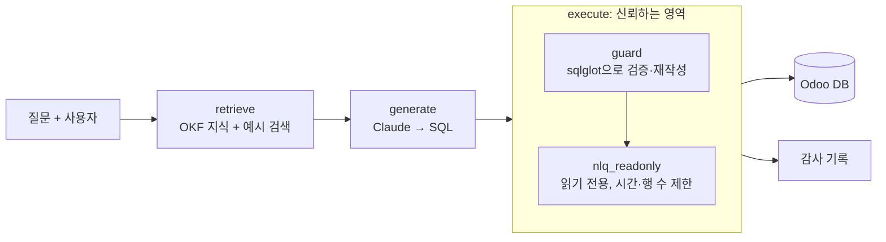

# erp-nlq

ERP 데이터를 한국어로 물으면 SQL로 바꿔 답하되, 사용자 권한 밖의 데이터는 LLM이 어떤 SQL을 만들어도 나오지 않게 코드로 강제하는 프로젝트.

데이터 소스는 Odoo Community 19.0 (LGPL-3.0)이며, Odoo 코드는 수정하지 않는다. DB에는 읽기 전용 역할을 추가하고, PUBLIC에 열린 스키마 생성·임시 테이블 권한만 회수한다.

> 상태: 계획한 1·2단계 기능을 모두 마쳤다(2026-11-09). 숫자는 [docs/plan.md](docs/plan.md)의 측정 기록에서 옮겼다. 하지 않기로 한 기능은 plan.md "2차 목록"에 있다.

**데모 영상 (1분 13초):** [docs/demo/erp-nlq-demo.mp4](docs/demo/erp-nlq-demo.mp4). 관리자와 영업 사원에게 같은 질문을 했을 때 결과 범위, 직접 고친 SQL에도 걸리는 권한, 위험한 SQL과 권한 밖 테이블 거부, 되묻기, 평가 결과 순서로 보여 준다. 화면 아래 자막만 있고 소리는 없다.

## 무엇이 다른가

자연어 → SQL 도구는 대개 "맞는 SQL을 만드는 것"을 목표로 한다. 업무 시스템에서는 그 SQL이 **질문한 사람이 볼 수 있는 행만** 읽어야 한다. 영업 사원은 자기 주문과 담당자 없는 주문만, 재고 담당은 고객 송장을 못 보는 식이다(Odoo의 Record Rules).

이 프로젝트는 LLM의 출력을 신뢰하지 않는다. 권한은 프롬프트가 아니라 실행 단계에서 코드로 건다.



- **guard**([backend/nlq/guard.py](backend/nlq/guard.py)): SQL을 구문 트리로 읽어 문장 하나·SELECT만, 테이블·함수·형 허용 목록을 검사한다. 행 범위가 있는 테이블은 권한 조건이 걸린 서브쿼리로 바꿔 끼운다. 규칙은 Odoo 그룹과 Record Rules를 옮긴 것이다([ADR 0003](docs/adr/0003-guard-rules-from-odoo-groups.md)).
- **RLS**: 같은 규칙을 Postgres RLS 정책으로도 구현해 비교했다(`NLQ_ENFORCE=guard|rls|both`, [ADR 0005](docs/adr/0005-rls-vs-guard.md)).
- **DB 역할**: 질의 계층은 superuser가 아닌 `nlq_readonly`·`nlq_rls`로만 접속한다. 쓰기, 위험 함수, 허용 밖 테이블은 DB 권한에서도 막는다.
- **감사 기록**: `execute()`가 시도마다 사용자·시각·결과 종류·값을 가린 SQL을 남긴다. 질문 원문과 값은 남기지 않는다([ADR 0006](docs/adr/0006-audit-log.md)).
- **왜 Odoo ORM API가 아니라 SQL인가**: ORM은 권한을 스스로 걸지만 `read_group`으로는 조인·구간 합계를 한 번에 하지 못하고, 이 프로젝트는 자연어 → SQL 도구가 만든 임의의 SQL에서도 권한이 지켜지는지를 잰다([ADR 0008](docs/adr/0008-sql-over-orm-api.md)).

구조와 신뢰 경계는 [docs/architecture.md](docs/architecture.md)에 있다.

## 결과

평가 세트는 50문항(판매 13·구매 12·재고 12·회계 13)이다. 문항마다 질문하는 사용자가 정해져 있다. 정답 SQL과 생성 SQL을 **그 사용자의 권한 범위로** 실행해 결과 집합을 비교한다(열 이름·반올림·행 순서 무시, [eval/README.md](eval/README.md)). 모델은 claude-haiku-5-5다.

### 권한

| 항목 | 결과 |
|---|---|
| Odoo 행 수 일치 (사용자 6명 × 테이블 14개, guard·RLS·둘 다) | 84/84 |
| 우회 테스트 (`backend/tests/test_guard.py`, RLS만 걸어도) | 통과 |
| Odoo 보고서 대조 (매출·수주액·미수금, 사용자별 17항목) | 정의 SQL 17/17, 시스템 답 17/17 |

### 정확도와 지식 층

| 구성 | 정답 (50문항) |
|---|---|
| 스키마만 (프롬프트만) | 41.0 (3회 평균) |
| 스키마 + 예시 검색 (RAG만, 키워드) | 41.7 (3회 평균) |
| 스키마 + 도메인 지식 묶음(OKF) | 45.7 (3회 평균) |
| OKF + 예시 검색(키워드) | 48.0 (3회 평균) |
| **OKF + 예시 검색 + 되묻기 (최종 구성)** | **48.3 (11-07 3회), 49.0 (11-09 3회)** |

- 도메인 지식 묶음(OKF, [knowledge/](knowledge/))은 테이블 14개, 데이터 함정 8개, 업무 흐름 2개, 매출·미수금 정의다. 예시만으로는 이를 대신하지 못한다. 회계가 가장 큰 차이를 보였다(RAG만 9.7/13 vs OKF + RAG 13.0/13).
- 최종 구성(OKF + 예시 검색 + 되묻기)을 claude-opus-5-5로 한 번 재면 47/50이다. Haiku의 같은 구성(세 번 48·48·49)과 회차 변동(±1~2) 안이라, 이 구성에서는 큰 모델로 바꿔도 점수가 오르지 않는다.
- 업무 기준이 갈리는 질문(주문/송장, 부가세, 환불 차감)에는 SQL 대신 되묻는다. 되묻기 세트 8문항은 끝까지 정답이 3.7개에서 8.0개로 늘었다. 기준이 정해진 50문항에서는 150번 중 한 번도 되묻지 않았다.

### WrenAI와 비교 (비교 기준 2)

같은 50문항과 채점 규칙, 같은 모델, 같은 지식(`knowledge/`, `eval/examples/`)을 WrenAI 0.29.2에 넣고 쟀다. 각 세 번의 평균이다(WrenAI 2026-11-08 한 번·11-09 두 번, 이 시스템 11-09 세 번, [docs/reference/wrenai.md](docs/reference/wrenai.md)).

| | 정답 | 우회 (권한 밖 행이 결과에 섞인 문항) |
|---|---|---|
| 이 시스템 | 49.0/50 (49·49·49) | 0 |
| WrenAI, 직접 실행 | 27.0/50 (27·27·27) | 9.3 (영업 사원 질문 15개 중, 9·9·10) |
| WrenAI SQL을 이 시스템의 `execute()`로 실행 | 33.0/50 (31·34·34) | 0 |

WrenAI 오픈소스에는 행 범위 기능이 없다. 같은 SQL이라도 `execute()`를 거치면 범위가 걸려 평균 6문항이 더 정답이 된다. WrenAI 엔진은 Odoo의 번역 jsonb 열(`name->>'en_US'`)을 다루지 못해 품목 이름이 필요한 문항에서 많이 틀렸다.

측정 조건과 회차별 숫자는 [docs/plan.md](docs/plan.md)에 있다. 결정 기록은 [docs/adr/](docs/adr/)에 있다.

## 로컬 실행

준비물: Docker, [uv](https://docs.astral.sh/uv/)(Python 3.12), Node.js·npm, Claude API 키(`ANTHROPIC_API_KEY`). Odoo와 Postgres는 127.0.0.1에만 열린다.

```bash
cp .env.example .env
docker compose up -d
```

1. 데모 데이터와 판매·구매·재고·회계 앱이 들어간 DB를 만든다. Odoo 19는 기본값이 데모 데이터 없음이라 `--with-demo`가 필요하다.

```bash
set -a; source .env; set +a
docker compose exec -T odoo odoo server --db_host db -r odoo -w "$ODOO_DB_PASSWORD" \
  -d "$ODOO_DB_NAME" -i sale_management,purchase,stock,account \
  --with-demo --stop-after-init --http-port 8070
```

2. 읽기 전용 역할(`nlq_readonly`, RLS 비교용 `nlq_rls`)과 RLS 정책을 만든다. 테이블 목록이나 `backend/nlq/identity.py`의 규칙을 고친 뒤에도 다시 실행한다.

```bash
./scripts/db-readonly-role.sh
```

3. 역할별 사용자(영업 사원 4명, 재고 담당 1명)를 만들고 주문·송장 담당자를 나눈 뒤, 평가용 기준 스냅숏을 저장한다. 데모의 Marc Demo에서 재고 그룹을 빼므로 원래 데모 설정과 다르다([ADR 0002](docs/adr/0002-separate-sales-and-stock-roles.md)).

```bash
./scripts/db-seed.sh
./scripts/db-snapshot.sh save
```

다시 같은 상태로 돌아가려면 `./scripts/db-snapshot.sh restore erp-YYYYMMDD.zip`을 실행한다.

http://localhost:8069 에 데모 관리자 계정으로 로그인할 수 있다.

4. 화면을 띄운다. API(127.0.0.1:8000)와 Next.js(127.0.0.1:3000)를 각각 실행한다. `.env`에 `ANTHROPIC_API_KEY`가 있어야 질문이 SQL로 바뀐다.

```bash
uv run --directory backend nlq-api
```

```bash
npm --prefix web install
npm --prefix web run dev
```

http://127.0.0.1:3000 에서 사용자를 고르고 질문한다. 만들어진 SQL은 고쳐서 다시 실행할 수 있고, 어느 쪽이든 `execute()`가 고른 사용자의 권한 범위를 건다. 로그인이 없는 데모라 두 서버 모두 127.0.0.1에만 연다.

터미널에서도 같은 순서(질문 → SQL → `execute()`)로 물을 수 있다.

```bash
uv run --directory backend nlq "지난달 확정된 판매 주문은 몇 건이야?" --user sales.kim
```

## 평가

```bash
uv run --directory backend pytest                    # 권한·우회·채점 테스트
uv run --directory backend nlq-eval                  # 50문항, 영역별 정확도
uv run --directory backend nlq-eval --clarify-set    # 되묻기 세트
uv run --directory backend nlq-report                # Odoo 보고서 대조
uv run --directory backend nlq-eval-wren setup|run   # WrenAI 비교 (docs/reference/wrenai.md)
```

평가 문항(`eval/questions/`)은 프롬프트 예시로 쓰지 않는다. 예시는 `eval/examples/`에서만 가져오고, 둘이 겹치지 않는지 테스트가 검사한다.

## 한계

- **데이터가 작다.** Odoo 데모 데이터(판매 주문 24건)라 guard와 RLS의 실행 시간 차이는 접속 시간에 묻혔다. 큰 테이블에서는 재지 않았다([ADR 0005](docs/adr/0005-rls-vs-guard.md)).
- **평가 세트는 직접 만든 50문항이다.** 한 스냅숏(`erp-20261103.zip`)과 고정한 "오늘"(2026-11-03)에서 쟀다. 회차 변동이 ±1~2문항이라 그보다 작은 차이는 읽지 않는다. Opus는 최종 구성을 한 번만 쟀다.
- **필드 단위 권한은 대조하지 않았다.** 행 범위와 테이블 권한은 Odoo와 맞췄지만, 허용 테이블 안 필드에 걸린 그룹 제한은 따로 보지 않았다(`res_users`만 열 5개로 좁힘, [ADR 0008](docs/adr/0008-sql-over-orm-api.md)).
- **감사 기록은 로컬 파일이다.** 변조를 막지 못한다([ADR 0006](docs/adr/0006-audit-log.md)).
- **화면에는 로그인이 없다.** 사용자를 고르는 것은 데모용이다. 그래서 API와 화면을 127.0.0.1에만 연다.
- **WrenAI 비교는 한 버전(0.29.2)이다.** 세 번 측정이 이틀(11-08, 11-09)에 걸쳤다. ORM API 방식의 정확도는 재지 않았다(2차 목록).

## CI

PR마다 `checks`(결정적 검사)와 `ai-review`(Claude 리뷰, [.github/review/prompt.md](.github/review/prompt.md))가 돈다. 둘 다 main 브랜치 보호의 필수 체크다. `checks`는 허용 테이블 축소 덤프(`eval/ci/erp-ci.sql.gz`)를 Postgres에 복원해 DB 테스트를 돌리고, 평가 20문항을 claude-haiku-5-5로 채점해 18 미만이면 실패한다. `checks`에는 레포 시크릿 `ANTHROPIC_API_KEY`가, `ai-review`에는 레포 시크릿 `CLAUDE_CODE_OAUTH_TOKEN`(Max 구독 토큰, `claude setup-token`으로 만든다)과 [Claude GitHub App](https://github.com/apps/claude) 설치가 필요하다.

질의 계층은 `localhost:5432`에 `NLQ_RO_USER`로 접속한다. 허용 테이블은 [db/readonly_role.sql](db/readonly_role.sql)에 있다.
