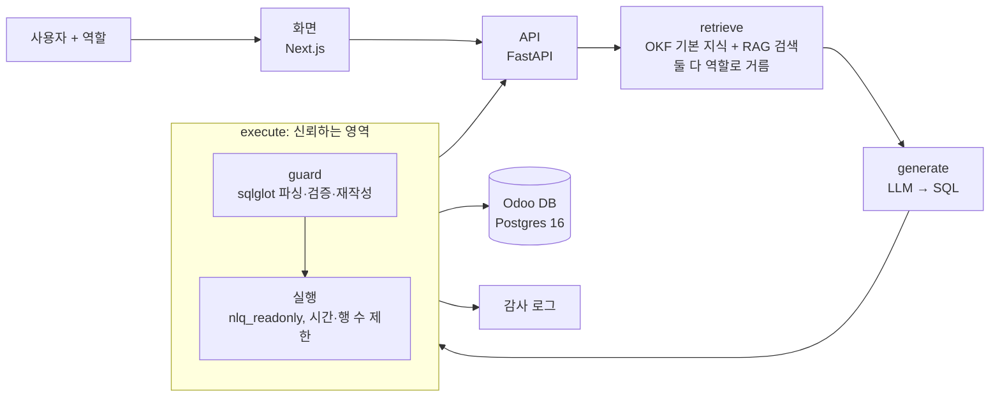

# 아키텍처

> 상태: 초안 (M1). 함수 경계와 신뢰 경계는 고정하고, 디렉터리 구조와 내부 구현은 만들면서 정한다. 바뀌면 이 문서를 같은 PR에서 고친다.

## 한 장 요약



- **신뢰하지 않는 영역:** 사용자 질문, `retrieve`, `generate`, LLM 출력 전부.
- **신뢰하는 영역:** `execute` 하나. 안에서 `guard`가 SQL을 검증하고 재작성한 뒤에만 실행한다. LLM이 어떤 SQL을 내도 권한 밖 행이 나오지 않는 이유가 여기에 있다.
- `retrieve`에서 역할 밖 테이블을 프롬프트에서 빼는 것은 **정보 노출을 줄이는 장치**다. 권한을 지키는 장치가 아니다. 빠져도 `execute`가 막아야 한다.

## 함수 경계

```python
def generate(question: str, user: User, failed: Failed | None = None) -> GeneratedSQL: ...   # LLM. 실패해도 안전
def execute(sql: str, user: User) -> Rows: ...                   # 권한 강제 + 실행. DB로 가는 유일한 길
```

### 자기 수정 (M5)

`execute`가 실패하면(guard 거부, DB 오류, 시간 초과) 그 SQL과 오류 메시지를 `generate(question, user, failed)`에 넣어 SQL을 **한 번** 다시 만들고 다시 `execute`한다. 순서는 [backend/nlq/ask.py](../backend/nlq/ask.py)의 `ask()`가 갖고 CLI와 평가가 쓴다. 화면은 같은 순서를 `POST /generate`(`failed` 포함)와 `POST /execute`로 밟는다.

- 다시 만든 SQL도 신뢰하지 않는다. `execute`가 처음부터 다시 검증하므로 재시도는 권한 범위를 넓히지 않는다. `ask()`는 두 함수를 부를 뿐 DB나 guard에 직접 닿지 않는다(`tests/test_boundary.py`).
- guard 거부 이유도 LLM에 돌려준다. 이유는 어떤 구문·테이블이 막혔는지뿐이고, 그것을 알고 다시 써도 범위 밖 행은 나오지 않는다.
- DB 오류 첫 줄에 범위 안 행의 값이 섞일 수 있다(예: 형 변환 실패한 값). 질문과 같은 길로 Claude API에만 가고 로그에는 남기지 않는다(절대 규칙 6).
- 실행은 됐지만 틀린 답은 다시 만들지 않는다. 정답을 모르는 상태에서는 틀렸는지 알 수 없기 때문이다.
- 시스템 프롬프트(캐시)는 바꾸지 않고, 앞 SQL과 오류는 사용자 메시지에 붙인다.

M4에서 [backend/nlq/api.py](../backend/nlq/api.py)(FastAPI)가 각각 `POST /generate`, `POST /execute`로 감쌌다. 화면은 이 두 API와 사용자 목록(`GET /users`, login과 역할 이름만)만 안다. 화면에는 로그인이 없고 사용자를 역할 선택으로 고르므로, API는 127.0.0.1에만 연다. 질문·SQL·결과는 로그에 남기지 않는다.

## 신원과 역할

- 신원은 Odoo 사용자(`res_users.id`)다. 평가와 화면에서는 역할 선택으로 사용자를 바꾼다.
- 역할은 Odoo 그룹을 따른다.

| 역할 | Odoo 그룹 | 판매 주문 범위 |
|---|---|---|
| 영업 사원 | `sales_team.group_sale_salesman` (재고 그룹 없음) | 내 주문 + 담당자 없는 주문 |
| 재고 담당 | `stock.group_stock_user` | 전체 (구매·재고도 전체, 고객 송장은 못 봄) |
| 영업 관리자 | `group_sale_salesman_all_leads` 이상 | 전체 |

Odoo가 권한을 합치는 방식(전역 규칙은 AND, 그룹 규칙은 OR)과 허용 테이블 13개별 규칙은 [reference/odoo-access-rules.md](reference/odoo-access-rules.md)에 있다. guard는 그 문서의 "전역 AND (그룹 OR)" 구조를 그대로 따른다. 역할을 이렇게 나눈 이유는 [ADR 0002](adr/0002-separate-sales-and-stock-roles.md)에 있다.

근거는 Odoo `sale/security/ir_rules.xml`의 `sale_order_personal_rule`이다.
`domain_force = ['|', ('user_id','=',user.id), ('user_id','=',False)]`
"자기 주문만"으로 구현하면 Odoo 화면과 결과 수가 달라진다. 담당자 없는 주문도 포함해야 한다. 구매·재고·회계 쪽 규칙은 M1에 같은 방식으로 읽고 이 표에 추가한다.

**회사 조건도 함께 걸린다.** 데모 데이터는 여러 회사에 걸쳐 있고(송장은 두 회사에 13건씩), Odoo는 담당자 규칙과 별개로 `company_id IN (사용자가 속한 회사)` 조건을 건다. 영업 사원 송장 규칙을 Odoo가 계산한 실제 도메인은 다음과 같다.
`company_id in [...] AND invoice_user_id in [uid, False] AND move_type in ('out_invoice','out_refund')`
따라서 guard의 행 범위는 항상 "담당자 조건 AND 회사 조건"이다. Odoo 화면은 사용자가 상단에서 고른 회사만 보여 주므로, 권한 일치 검증은 "속한 회사 전체를 고른 상태"를 기준으로 한다.

권한 일치는 XML-RPC 대신 `odoo shell`의 ORM으로 확인한다([ADR 0003](adr/0003-guard-rules-from-odoo-groups.md)). [scripts/odoo_counts.py](../scripts/odoo_counts.py)가 사용자·테이블마다 `with_user(user).search_count([])`(보관 포함, 속한 회사 전체)를 세고, `backend/tests/test_odoo_scope.py`가 guard를 거친 `SELECT count(*)`와 비교한다.

## guard: 구문 트리 방식 (1단계)

`sqlglot`으로 파싱한 트리에 대해 다음을 차례로 한다. 하나라도 걸리면 실행하지 않는다.

1. 문장이 정확히 하나이고 `SELECT`(CTE 포함)인지 확인한다.
2. 등장하는 모든 테이블이 역할의 허용 목록에 있는지 확인한다. 서브쿼리와 CTE 안까지 본다.
3. 모든 함수가 허용 목록에 있는지 확인한다. `set_config`, `pg_sleep`, `current_setting`, `dblink` 계열 등은 차단한다.
4. 행 범위가 있는 테이블마다, 테이블이 등장하는 자리를 권한 조건이 걸린 서브쿼리로 바꾼다.
   예: `sale_order` → `(SELECT * FROM sale_order WHERE (user_id = :uid OR user_id IS NULL) AND company_id IN :companies) AS sale_order`
   WHERE 절에 조건을 덧붙이는 방식은 OR, 조인, 서브쿼리에서 새기 쉬워 쓰지 않는다.
5. 바깥에 `LIMIT`을 강제한다.

구현은 [backend/nlq/guard.py](../backend/nlq/guard.py)와 [backend/nlq/identity.py](../backend/nlq/identity.py)다.
- 2·3번은 허용 목록이다. 트리의 모든 노드(구문, 함수, 형)가 목록에 있어야 하고, 모르는 것은 거부한다. 원문이 아니라 검증한 트리를 다시 만든 SQL을 실행하고, 주석은 버린다.
- 괄호로 묶은 조인 `LEFT JOIN (a JOIN b ON ...) ON ...`은 sqlglot이 첫 테이블 `a`에 나머지 조인을 붙인 꼴로 파싱한다. guard는 `a`를 행 범위 서브쿼리로 바꾸면서 붙어 있던 조인을 그 서브쿼리로 옮기고, 묶음 안 테이블은 다른 테이블처럼 하나씩 검사하고 바꾼다. 묶음에 별칭을 붙여도(`(a JOIN b) AS j`) 마찬가지다.
- jsonb 키 존재(`?`, `?|`, `?&`)와 포함(`@>`, `<@`) 연산자는 허용한다. 이미 범위 안에서 읽은 값끼리 비교만 하고 다른 행·테이블·함수에 닿지 않아, `->>`로 값을 꺼내 보는 것 이상을 드러내지 않는다. Odoo 19의 회사별 값(`standard_price` 등)이 `{"회사 id": 값}` jsonb라 `standard_price ? '1'` 꼴로 쓰인다. `jsonb` 형 변환은 여전히 형 허용 목록 밖이다.
- 테이블 참조가 CTE를 가리키는지는 Postgres의 이름 규칙대로 판단한다. 재귀 아닌 `WITH` 안에서는 앞서 정의된 CTE만 보이고, 서브쿼리의 CTE는 바깥에서 보이지 않는다. 확실하지 않으면 실제 테이블로 보고 검사한다.
- 사용자가 읽을 수 있는 테이블과 행 범위를 정하는 그룹은 Odoo에서 뽑은 `eval/users.toml`에서, 규칙은 `identity.py`에서 온다. 결정 이유는 [ADR 0003](adr/0003-guard-rules-from-odoo-groups.md).
- `res_users`는 `company_ids`(다대다)를 열지 않아 `company_id`로 좁힌다. Odoo보다 넓어지지 않는다.

## 실행 안전장치

| 층 | 무엇을 막나 | 위치 |
|---|---|---|
| `nlq_readonly` 역할 | 허용 테이블 밖 읽기, 모든 쓰기, 스키마·임시 테이블 생성 | [db/readonly_role.sql](../db/readonly_role.sql) |
| `default_transaction_read_only` | 쓰기 (세션에서 끌 수 있어 보조 장치) | 같은 파일 |
| 위험 함수 실행 권한 회수 | guard 파서가 놓친 `set_config`·`current_setting`·`pg_sleep*`·`*_to_xml*`(문자열 SQL을 행 범위 재작성 없이 실행)·`lo_*`·서버 파일 함수·`dblink*`. 대부분 PUBLIC에 열려 있어 PUBLIC에서 회수한다. Odoo는 superuser라 영향이 없다. 목록 밖 함수(`pg_advisory_lock*`, `pg_notify`, `pg_cancel_backend` 등)는 열려 있어 guard 함수 허용 목록이 유일한 방어선이다 | 같은 파일 |
| 서버 커서(`DECLARE CURSOR`) | SELECT가 아닌 문장, 여러 문장, 쓰기 CTE, `FOR UPDATE` | `execute` (M2) |
| `statement_timeout` 10초, 행 수 1,000행 | 느린 쿼리, 큰 결과. `SET LOCAL`로 건다(`set_config`는 실행 권한이 없다). FETCH는 한 번만 해서, 설정을 바꿀 길이 생겨도 그 문장에는 적용되지 않는다 | `execute` (M2) |
| 접속 역할 확인 | superuser·BYPASSRLS 역할로 접속하면 실행하지 않는다 | `execute` (M2) |
| guard | 권한 밖 행, 위험 함수, 여러 문장 | `execute` (M3) |

## RLS 방식 (2단계, M6 비교용)

같은 규칙을 Postgres RLS 정책으로 구현해 구문 트리 방식과 비교한다.

- 사용자 값은 `SET LOCAL nlq.user_id = ...`로 넘긴다. 사용자 SQL이 `set_config`로 이 값을 바꾸지 못하게 guard의 함수 허용 목록이 함께 필요하다. `nlq_readonly`는 `current_setting`도 실행할 수 없으므로(위 "실행 안전장치"), 정책이 이 값을 읽을 때는 `nlq.user_id`만 돌려주는 SECURITY DEFINER 함수를 따로 둔다.
- 정책은 `nlq_readonly`에만 적용한다. `FORCE ROW LEVEL SECURITY`는 쓰지 않는다. 소유자인 Odoo가 영향을 받기 때문이다.
- `odoo`는 superuser라 RLS를 항상 건너뛴다. 측정은 반드시 `nlq_readonly`로 한다.

## 데이터

- Odoo Community 19.0 데모 데이터. DB 이름은 `.env`의 `ODOO_DB_NAME`(기본값 `erp`)이다.
- 평가가 재현되도록 `pg_dump` 스냅숏과 "오늘 날짜" 고정값을 함께 쓴다(M1).
- 허용 테이블 후보는 `db/readonly_role.sql`에 있다. M1에 10개 안팎으로 확정한다.
- 알려진 함정은 다음과 같다. 상세는 M1에서 `knowledge/`의 OKF 문서로 정리한다(아래 "지식 층").
  - `name` 등 번역 필드가 jsonb다.
  - `account_move`는 `move_type`(송장·환불·전표)과 `state`를 같이 봐야 한다.
  - `res_partner`에 회사와 담당자가 섞여 있다.
  - 매출은 주문 기준인지 송장 기준인지, 부가세를 포함하는지(`amount_untaxed`와 `amount_total`)에 따라 달라진다.

## 지식 층: OKF + RAG

`generate`에 넘기는 컨텍스트는 두 층이다. 둘 다 `retrieve`가 역할로 거른 뒤에 넘긴다.

| 층 | 무엇을 | 어떻게 넣나 |
|---|---|---|
| **OKF 묶음** (`knowledge/`) | 사람이 다듬은 작고 정확한 지식: 확정 테이블 설명, 데이터 함정, 업무 흐름, 매출·미수금 지표 정의 | 역할이 볼 수 있는 문서는 **항상** 넣는다 |
| **RAG** (pgvector) | 너무 커서 다듬을 수 없는 것: 열 단위 스키마, 예시 질문-SQL(`eval/examples/`) | 질문마다 검색해서 넣는다 |

OKF 문서 규칙은 다음과 같다. OKF는 v0.1 초안이라 필수 필드 `type`만 규격을 따르고, 나머지는 이 프로젝트의 규칙이다.

```markdown
---
type: metric            # table | metric | flow | pitfall
title: 매출
tables: [account_move, account_move_line]   # 역할로 거를 때 쓴다
tags: [회계]
---
매출 = 확정(state='posted')된 고객 송장(move_type='out_invoice')에서 환불(out_refund)을 뺀 값, 부가세 제외(amount_untaxed).
관련: [미수금](receivable.md), [account_move](../tables/account_move.md)
```

- 문서의 `tables`에 역할 밖 테이블이 하나라도 있으면 그 문서는 빼고 넘긴다.
- 지표 정의는 Odoo 소스나 보고서 화면을 근거로 쓰고, 근거를 본문에 링크한다.
- 평가용 질문과 정답 SQL은 OKF 문서에 넣지 않는다. 절대 규칙 4가 여기에도 적용된다.
- M5에서 같은 50문항으로 "RAG만"과 "OKF + RAG"를 비교한다.

M2의 `generate`는 검색 없이 지침, 열 목록([db/schema.txt](../db/schema.txt), `scripts/db-schema.sh`로 생성), OKF 묶음 전체를 시스템 프롬프트 하나로 넣고 캐시한다. `generate`는 DB에 접속하지 않으므로 열 목록은 파일로만 받는다. 역할별로 거르는 것은 M3에서 역할별 허용 테이블 목록이 생기면 붙인다.

## 평가

- `eval/questions/`에 평가용 50문항을 둔다. 판매·구매·재고·회계 영역 태그와 정답 SQL을 붙이고, 프롬프트에 쓰지 않는다.
- `eval/examples/`에 예시용 문항을 둔다. few-shot에는 여기 것만 쓴다.
- 채점은 실행 결과 집합을 비교한다. 행 순서, 열 이름, 반올림 차이는 무시한다. 영역별 정확도와 권한 우회 건수를 함께 낸다.
- 평가는 Claude API로 돌린다. 모델은 `EVAL_MODEL`에 Claude 모델 ID를 넣어 바꾼다. 결과마다 모델과 프롬프트 버전을 기록한다.

## 모델

- 모델은 설정 한 줄로 바꿀 수 있게 만든다.
- **생성과 평가 모두 Claude API를 쓴다.** API 키는 `.env`의 `ANTHROPIC_API_KEY`다. 평가 전용 키를 만들고 콘솔에서 월 한도를 건다.
- CI의 `ai-review`는 API 키가 아니라 Max 구독 토큰(`CLAUDE_CODE_OAUTH_TOKEN`)으로 돈다. 앱 코드는 구독 토큰을 쓰지 않는다.
- 반복 개발, 프롬프트 개선, CI에는 `claude-haiku-5-5`를 쓴다. 결과 표에 넣을 측정에만 `claude-opus-5-5`를 쓴다. 두 점수를 섞지 않는다.
- 로컬 모델(Ollama)은 지금 쓰지 않는다. 오픈 모델 비교는 2차 목록에 있다.

## 디렉터리 (계획)

```
backend/            Python, FastAPI
  nlq/
    generate.py     질문 → SQL
    retrieve.py     OKF 묶음 + RAG 검색, 역할별 거르기 (2단계)
    guard.py        sqlglot 검증·재작성
    execute.py      guard + 실행. DB로 가는 유일한 경로
    identity.py     사용자·역할 → 허용 테이블과 행 범위
  tests/            우회 테스트 포함
knowledge/          OKF 묶음: tables/, metrics/, flows/, pitfalls/
eval/
  questions/        평가용 (프롬프트 사용 금지)
  examples/         예시용
web/                Next.js
db/                 DB 역할·정책 SQL
scripts/            운영 스크립트
docs/               architecture, plan, adr, reference, retro (troubleshooting은 드라이브)
```
