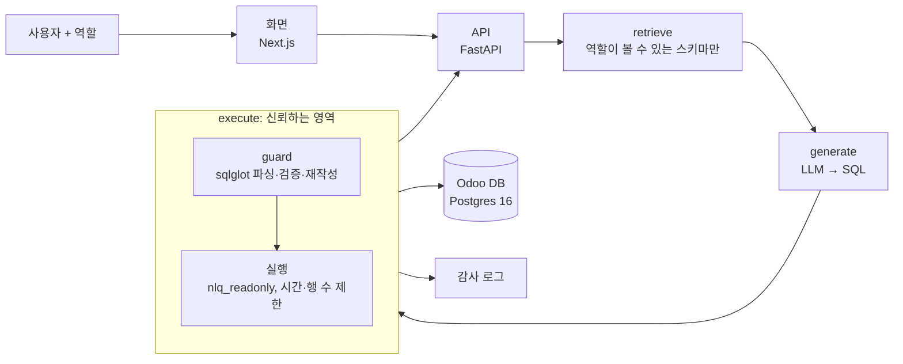

# 아키텍처

> 상태: 초안 (M1). 함수 경계와 신뢰 경계는 고정하고, 디렉터리 구조와 내부 구현은 만들면서 정한다. 바뀌면 이 문서를 같은 PR에서 고친다.

## 한 장 요약



- **신뢰하지 않는 영역:** 사용자 질문, `retrieve`, `generate`, LLM 출력 전부.
- **신뢰하는 영역:** `execute` 하나. 안에서 `guard`가 SQL을 검증하고 재작성한 뒤에만 실행한다. LLM이 어떤 SQL을 내도 권한 밖 행이 나오지 않는 이유가 여기에 있다.
- `retrieve`에서 역할 밖 테이블을 프롬프트에서 빼는 것은 **정보 노출을 줄이는 장치**다. 권한을 지키는 장치가 아니다. 빠져도 `execute`가 막아야 한다.

## 함수 경계

```python
def generate(question: str, user: User) -> GeneratedSQL: ...   # LLM. 실패해도 안전
def execute(sql: str, user: User) -> Rows: ...                   # 권한 강제 + 실행. DB로 가는 유일한 길
```

나중에 각각 `POST /generate`, `POST /execute`로 감싼다. 화면은 두 API만 안다.

## 신원과 역할

- 신원은 Odoo 사용자(`res_users.id`)다. 평가와 화면에서는 역할 선택으로 사용자를 바꾼다.
- 역할은 Odoo 그룹을 따른다.

| 역할 | Odoo 그룹 | 판매 주문 범위 |
|---|---|---|
| 영업 사원 | `sales_team.group_sale_salesman` | 내 주문 + 담당자 없는 주문 |
| 영업 관리자 | `group_sale_salesman_all_leads` 이상 | 전체 |

근거는 Odoo `sale/security/ir_rules.xml`의 `sale_order_personal_rule`이다.
`domain_force = ['|', ('user_id','=',user.id), ('user_id','=',False)]`
"자기 주문만"으로 구현하면 Odoo 화면과 결과 수가 달라진다. 담당자 없는 주문도 포함해야 한다. 구매·재고·회계 쪽 규칙은 M1에 같은 방식으로 읽고 이 표에 추가한다.

## guard: 구문 트리 방식 (1단계)

`sqlglot`으로 파싱한 트리에 대해 다음을 차례로 한다. 하나라도 걸리면 실행하지 않는다.

1. 문장이 정확히 하나이고 `SELECT`(CTE 포함)인지 확인한다.
2. 등장하는 모든 테이블이 역할의 허용 목록에 있는지 확인한다. 서브쿼리와 CTE 안까지 본다.
3. 모든 함수가 허용 목록에 있는지 확인한다. `set_config`, `pg_sleep`, `current_setting`, `dblink` 계열 등은 차단한다.
4. 행 범위가 있는 테이블마다, 테이블이 등장하는 자리를 권한 조건이 걸린 서브쿼리로 바꾼다.
   예: `sale_order` → `(SELECT * FROM sale_order WHERE user_id = :uid OR user_id IS NULL) AS sale_order`
   WHERE 절에 조건을 덧붙이는 방식은 OR, 조인, 서브쿼리에서 새기 쉬워 쓰지 않는다.
5. 바깥에 `LIMIT`을 강제한다.

## 실행 안전장치

| 층 | 무엇을 막나 | 위치 |
|---|---|---|
| `nlq_readonly` 역할 | 허용 테이블 밖 읽기, 모든 쓰기, 스키마·임시 테이블 생성 | [db/readonly_role.sql](../db/readonly_role.sql) |
| `default_transaction_read_only` | 쓰기 (세션에서 끌 수 있어 보조 장치) | 같은 파일 |
| `statement_timeout`, 행 수 제한 | 느린 쿼리, 큰 결과 | `execute` (M2) |
| guard | 권한 밖 행, 위험 함수, 여러 문장 | `execute` (M3) |

## RLS 방식 (2단계, M6 비교용)

같은 규칙을 Postgres RLS 정책으로 구현해 구문 트리 방식과 비교한다.

- 사용자 값은 `SET LOCAL nlq.user_id = ...`로 넘긴다. 사용자 SQL이 `set_config`로 이 값을 바꾸지 못하게 guard의 함수 허용 목록이 함께 필요하다.
- 정책은 `nlq_readonly`에만 적용한다. `FORCE ROW LEVEL SECURITY`는 쓰지 않는다. 소유자인 Odoo가 영향을 받기 때문이다.
- `odoo`는 superuser라 RLS를 항상 건너뛴다. 측정은 반드시 `nlq_readonly`로 한다.

## 데이터

- Odoo Community 19.0 데모 데이터. DB 이름은 `.env`의 `ODOO_DB_NAME`(기본값 `erp`)이다.
- 평가가 재현되도록 `pg_dump` 스냅숏과 "오늘 날짜" 고정값을 함께 쓴다(M1).
- 허용 테이블 후보는 `db/readonly_role.sql`에 있다. M1에 10개 안팎으로 확정한다.
- 알려진 함정은 다음과 같다. 상세는 M1에 `docs/domain/`에 정리한다.
  - `name` 등 번역 필드가 jsonb다.
  - `account_move`는 `move_type`(송장·환불·전표)과 `state`를 같이 봐야 한다.
  - `res_partner`에 회사와 담당자가 섞여 있다.
  - 매출은 주문 기준인지 송장 기준인지, 부가세를 포함하는지(`amount_untaxed`와 `amount_total`)에 따라 달라진다.

## 평가

- `eval/questions/`에 평가용 50문항을 둔다. 판매·구매·재고·회계 영역 태그와 정답 SQL을 붙이고, 프롬프트에 쓰지 않는다.
- `eval/examples/`에 예시용 문항을 둔다. few-shot에는 여기 것만 쓴다.
- 채점은 실행 결과 집합을 비교한다. 행 순서, 열 이름, 반올림 차이는 무시한다. 영역별 정확도와 권한 우회 건수를 함께 낸다.
- 평가는 Claude API로 돌린다. 모델은 `EVAL_MODEL`에 Claude 모델 ID를 넣어 바꾼다. 결과마다 모델과 프롬프트 버전을 기록한다.

## 모델

- 모델은 설정 한 줄로 바꿀 수 있게 만든다.
- **생성과 평가 모두 Claude API를 쓴다.** API 키는 `.env`의 `ANTHROPIC_API_KEY`다. 평가 전용 키를 만들고 콘솔에서 월 한도를 건다.
- 반복 개발, 프롬프트 개선, CI에는 `claude-haiku-5-5`를 쓴다. 결과 표에 넣을 측정에만 `claude-opus-5-5`를 쓴다. 두 점수를 섞지 않는다.
- 로컬 모델(Ollama)은 지금 쓰지 않는다. 오픈 모델 비교는 2차 목록에 있다.

## 디렉터리 (계획)

```
backend/            Python, FastAPI
  nlq/
    generate.py     질문 → SQL
    retrieve.py     스키마 검색, 역할별 거르기 (2단계)
    guard.py        sqlglot 검증·재작성
    execute.py      guard + 실행. DB로 가는 유일한 경로
    identity.py     사용자·역할 → 허용 테이블과 행 범위
  tests/            우회 테스트 포함
eval/
  questions/        평가용 (프롬프트 사용 금지)
  examples/         예시용
web/                Next.js
db/                 DB 역할·정책 SQL
scripts/            운영 스크립트
docs/               architecture, plan, adr, troubleshooting, domain, retro
```
