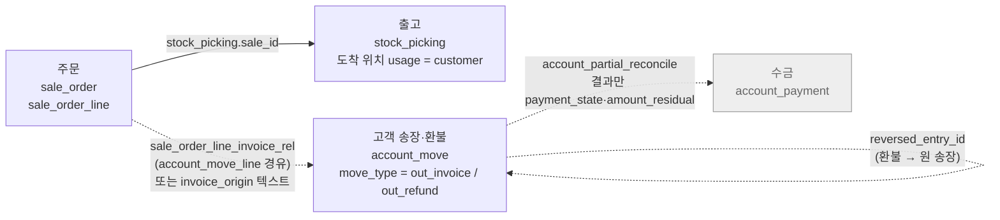
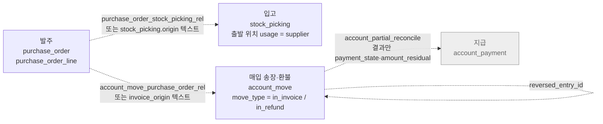

# 업무 흐름 지도 (M1)

> 판매·구매 흐름의 각 단계가 어느 테이블·열에 남는지, 단계끼리 무엇으로 이어지는지 정리한다.
> 근거는 Odoo 19.0 소스(컨테이너 `/usr/lib/python3/dist-packages/odoo/addons`)와 스냅숏 `erp-20261103`을 `nlq_readonly`로 조회한 결과다.
> 허용 테이블은 [db/readonly_role.sql](../../db/readonly_role.sql)의 13개다. 고른 이유는 [odoo-access-rules.md](odoo-access-rules.md)를 본다.
> 이 문서는 사람이 읽는 지도다. `generate`에 넘길 흐름 문서(OKF `type: flow`)는 이것을 바탕으로 `knowledge/`에 따로 쓴다.

## 지도

실선은 허용 테이블 안에서 열 하나로 조인할 수 있는 연결이다. 점선은 허용하지 않은 테이블을 거쳐야 하거나 텍스트로만 이어지는 연결이다. 회색 상자는 허용하지 않은 테이블이다.

### 판매

### 구매

단계 사이의 연결 테이블은 하나도 허용하지 않았다. 그래서 질의 계층은 **주문 쪽 상태 열**로 다음 단계의 진행을 판단한다. 문서끼리 직접 조인할 수 있는 것은 주문→출고(`stock_picking.sale_id`) 하나뿐이다.

## 단계별 테이블과 열

### 판매: 주문 → 출고 → 송장 → 수금

| 단계 | 테이블 | 거르는 조건 | 진행을 보는 열 | 다음 단계와의 연결 |
|---|---|---|---|---|
| 주문 | `sale_order`, `sale_order_line`(`order_id`) | 확정 주문은 `state = 'sale'`. `draft`·`sent`는 견적 | `delivery_status`, `invoice_status`, 라인의 `qty_delivered`·`qty_invoiced`·`qty_to_invoice` | — |
| 출고 | `stock_picking` | `location_dest_id` → `stock_location.usage = 'customer'` | `state`(`draft`→`waiting`/`confirmed`→`assigned`→`done`, `cancel`), `date_done` | `stock_picking.sale_id = sale_order.id` (저장된 열) |
| 송장 | `account_move` | `move_type = 'out_invoice'`, `state = 'posted'` | `payment_state`, `amount_residual`, `invoice_date_due` | 주문과는 허용 테이블 안에서 이어지지 않는다(아래 "끊긴 연결") |
| 환불 | `account_move` | `move_type = 'out_refund'`, `state = 'posted'` | 송장과 같다 | `reversed_entry_id` → 원 송장 |
| 수금 | `account_payment` (허용 안 함) | — | 송장의 `payment_state`(`not_paid`·`partial`·`in_payment`·`paid`·`reversed` 등)와 `amount_residual` | — |

### 구매: 발주 → 입고 → 매입 송장 → 지급

| 단계 | 테이블 | 거르는 조건 | 진행을 보는 열 | 다음 단계와의 연결 |
|---|---|---|---|---|
| 발주 | `purchase_order`, `purchase_order_line`(`order_id`) | 확정 발주는 `state = 'purchase'`. `draft`·`sent`는 견적 요청 | `receipt_status`, `invoice_status`, 라인의 `qty_received`·`qty_invoiced`·`qty_to_invoice` | — |
| 입고 | `stock_picking` | `location_id` → `stock_location.usage = 'supplier'` | `state`, `date_done` | 저장된 열이 없다. `purchase_id`는 계산 필드라 DB 열이 없다 |
| 매입 송장 | `account_move` | `move_type = 'in_invoice'`, `state = 'posted'` | `payment_state`, `amount_residual` | 발주와는 허용 테이블 안에서 이어지지 않는다 |
| 매입 환불 | `account_move` | `move_type = 'in_refund'` | 같음 | `reversed_entry_id` |
| 지급 | `account_payment` (허용 안 함) | — | 매입 송장의 `payment_state`·`amount_residual` | — |

출고와 입고를 가르는 열은 `stock_picking.picking_type_id`이지만 `stock_picking_type`은 허용하지 않았다. `picking_type_code`도 저장되지 않는 열이다. 그래서 위치의 `usage`로 가른다.

## 끊긴 연결

| 연결 | Odoo가 실제로 쓰는 경로 | 허용 테이블 안의 대안 | 데모 데이터에서 |
|---|---|---|---|
| 판매 주문 ↔ 고객 송장 | `sale_order_line_invoice_rel`(주문 라인 ↔ `account_move_line`) | `account_move.invoice_origin = sale_order.name` (텍스트, 여러 주문이면 `", "`로 합쳐짐) | `invoice_origin`이 모든 송장에서 비어 있다 |
| 발주 ↔ 입고 | `stock_move.purchase_line_id`, 저장된 `purchase_order_stock_picking_rel` | `stock_picking.origin = purchase_order.name` (텍스트) | 입고 6건 중 1건만 `origin`이 발주 이름과 맞는다 |
| 발주 ↔ 매입 송장 | `account_move_line.purchase_line_id`, 저장된 `account_move_purchase_order_rel` | `invoice_origin` (텍스트) | `invoice_origin`이 모든 매입 송장에서 비어 있다 |
| 송장 ↔ 수금·지급 | `account_partial_reconcile`, `account_payment` | `payment_state`, `amount_residual` | 모든 송장이 `not_paid`다 |

정리하면 다음과 같다. "주문별 송장 금액"이나 "발주별 입고 일자"처럼 문서를 짝지어야 하는 질문은 지금 권한으로는 정확히 답할 수 없다. 이런 질문이 평가 문항에 들어가면 연결 테이블을 열지, 문항을 빼지 정한다. 연결 테이블을 열면 [odoo-access-rules.md](odoo-access-rules.md)와 `db/readonly_role.sql`을 함께 고친다.

## 흐름을 질문에 쓸 때 걸리는 함정

조회로 확인한 것들이다. OKF 묶음의 `pitfall` 문서로 옮긴다.

1. **`delivery_status`·`receipt_status`가 NULL이면 "출고 전"이 아니라 "출고 문서 없음"이다.** Odoo는 연결된 picking이 없거나, 전부 완료·취소이면서 재고로 배송하는 라인의 출고 수량이 0일 때 False(NULL)를 넣는다(`sale_stock/models/sale_order.py` `_compute_delivery_status`). 데모의 확정 주문 19건 중 15건이 NULL이고, picking이 붙은 4건만 `pending`이다. "미출고 확정 주문"을 `delivery_status <> 'full'`로 쓰면 NULL이 빠진다.
2. **출고 picking 대부분이 주문과 이어져 있지 않다.** 고객 출고 43건 중 `sale_id`가 있는 것은 4건이다. 완료된 30건은 모두 `sale_id`와 `origin`이 비어 있다. "출고 완료 건수"와 "출고된 주문 수"는 다른 숫자다.
3. **같은 송장 번호가 회사마다 있다.** 데모는 회사 1(San Francisco)과 회사 2(My US Company)에 같은 송장 16건씩을 만든다. 번호(`name`)는 회사 안에서만 고유하다. 회사 조건 없이 합치면 미수금이 두 배가 된다. 판매·구매·재고 문서는 모두 회사 1에만 있다.
4. **`amount_residual`은 부호가 없다.** 환불도 양수다. 부호가 있는 열은 `amount_total_signed`·`amount_untaxed_signed`(고객 환불·매입 송장이 음수)다. 미수금을 합칠 때 환불을 빼려면 `move_type`으로 부호를 붙인다.
5. **환불이 원 송장과 이어져 있지 않다.** 데모 고객 환불(회사마다 4건)과 매입 환불 모두 `reversed_entry_id`가 비어 있다. 환불을 원 송장에서 빼는 질문은 거래처 단위로만 맞출 수 있다.
6. **`move_type = 'entry'`는 송장이 아니다.** 일반 전표 24건이 같은 테이블에 있다. 송장 질문은 항상 `move_type`을 건다.

## 데모 데이터의 흐름 현황

스냅숏 `erp-20261103` 기준이다(회사 1).

| | 견적 | 확정 | 다음 단계 연결 |
|---|---|---|---|
| 판매 주문 24건 | `draft` 4, `sent` 1 | `sale` 19 | 출고 문서 있음 4 (모두 `pending`), 송장 대기(`invoice_status = 'to invoice'`) 1 |
| 발주 11건 | `draft` 6, `sent` 1 | `purchase` 4 | 입고 문서 있음 1 (`pending`) |
| 고객 출고 43건 | | 완료 30, 준비 10, 기타 3 | 주문 연결 4 |
| 입고 6건 | | 준비 4, 초안 2 | 발주 연결(`origin`) 1 |
| 고객 송장 9건·환불 4건 | | 모두 `posted`, `not_paid` | 주문 연결 0 |
| 매입 송장 2건·환불 1건 | | 모두 `posted`, `not_paid` | 발주 연결 0 |

송장 수는 회사 1 기준이다. 회사 2에도 같은 수가 있다. 데모 데이터는 흐름의 끝(수금·지급)까지 간 문서가 없다. 흐름 전체를 따라가는 평가 문항을 만들려면 시드에서 주문 하나를 출고·송장·수금까지 진행하는 방법이 있다. 필요해지면 그때 정한다.
